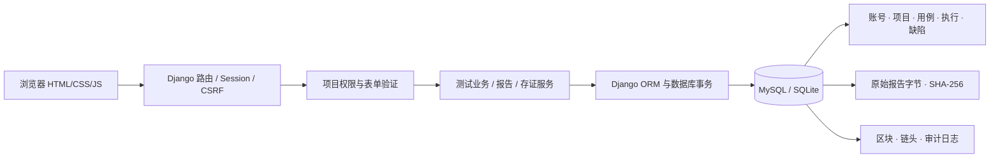
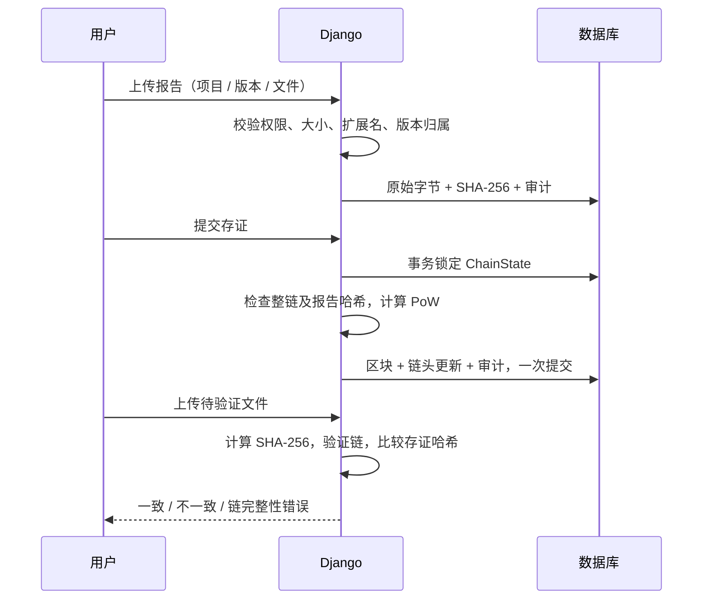

# 系统架构

## 代码结构

- `config/`：环境配置、网站入口、WSGI。
- `core/models.py`：实体、主外键和数据库约束。
- `core/forms.py`：字段验证、项目归属边界与文件校验。
- `core/views.py`：权限验证、页面处理与统计接口。
- `core/services.py`：报告生成、哈希计算、事务存证与整链验证。
- `core/migrations/`：可复现的数据库变更。
- `core/management/commands/`：备份和链检查。
- `templates/`、`static/`：完整网页与响应式样式。
- `core/tests/`：功能、安全边界和一致性测试。

## 存证时序

用户实际执行测试后录入结果；系统负责管理过程和保存报告，不自动启动外部软件测试。文件一致性不等于测试结果真实性。

## 运行模式

本地 SQLite 模式与 MySQL 模式使用同一套业务代码。正式进程由 Gunicorn 承载，静态资源由 WhiteNoise 服务，HTTPS 在可信反向代理终结。数据库迁移在启动时执行，所有业务数据跨进程重启保留。
