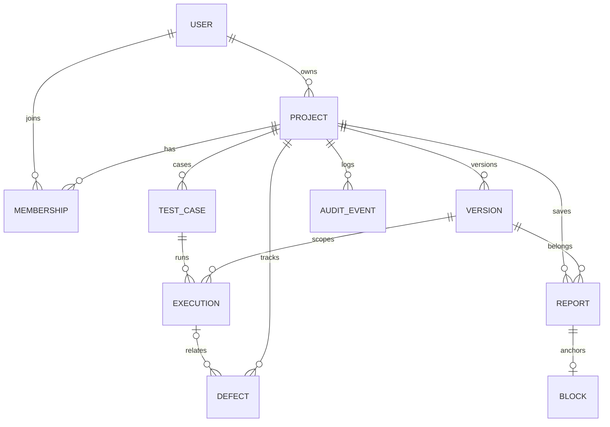

# 数据库设计

主键默认使用 BigAutoField。用户、Session、用户组与系统权限使用 Django auth/session 内置表；下列实体使用 `core_` 表名前缀。

| 实体 | 核心字段与约束 |
| --- | --- |
| Project | id PK；name varchar(120) 非空；description text；owner_id FK User，PROTECT；archived bool；created_at |
| Membership | id PK；project_id FK CASCADE；user_id FK CASCADE；role 限定 manager/tester/viewer；(project_id,user_id) UNIQUE |
| Version | id PK；project_id FK CASCADE；name varchar(60) 非空；description text；created_at；(project_id,name) UNIQUE |
| TestCase | id PK；project_id FK CASCADE；creator_id FK PROTECT；title/steps/expected 非空；priority 限定 high/normal/low；archived；created_at/updated_at |
| Execution | id PK；case_id FK PROTECT；version_id FK PROTECT；executor_id FK PROTECT；status 限定 passed/failed/blocked；actual text；case_snapshot JSON；created_at |
| Defect | id PK；project_id FK CASCADE；execution_id FK PROTECT，可空；creator_id FK PROTECT；assignee_id FK SET_NULL，可空；title/description；status 限定 open/fixed/closed；时间 |
| Report | id PK；project_id/version_id/creator_id FK PROTECT；title；filename varchar(200)；data binary/MySQL longblob；sha256 char(64) 索引；size 非负；generated；created_at |
| Block | id PK；height 非负 UNIQUE；report_id 一对一 FK PROTECT；payload JSON；previous_hash/block_hash char(64)，后者 UNIQUE；nonce 非负；difficulty；timestamp；created_at |
| ChainState | id 固定为 1；tip_hash char(64)；next_height 非负；迁移建立初始记录 |
| AuditEvent | id PK；project_id FK CASCADE；actor_id FK SET_NULL；action varchar(160)；created_at |
| LoginAttempt | id PK；key char(64) UNIQUE，用户名 SHA-256；failures 非负；updated_at；用于限制连续登录失败 |

## 业务一致性

- 用例和执行版本必须属于同一项目；缺陷负责人只能为项目成员或负责人。表单查询集与服务层实施项目边界验证。
- 多次执行独立追加，用例快照保留执行时的标题、步骤、预期及优先级。
- 统计取每个用例在所选版本中最新一条执行记录；全部版本统计取跨版本最新执行。有效用例归档后不计入当前进度。
- 报告先保存原始字节，再计算 SHA-256；报告上传、审计事件在同一事务提交。
- 存证锁定 ChainState，校验已有链和报告，再挖矿、追加 Block、更新链头并记日志，同一事务提交；数据库唯一约束防止重复报告存证和重复高度。
- MySQL 使用 InnoDB；SQLite 在写争用时通过有限重试处理锁冲突。
- 报告二进制字段便于将报告与区块整体备份。当前单文件 10 MB，海量文件场景可迁移至私有对象存储并保留哈希核验。

数据库结构以 `core/models.py` 与版本化 `core/migrations/` 为准。执行 `python manage.py sqlmigrate core 0001` 可导出当前数据库对应的建表 SQL。
